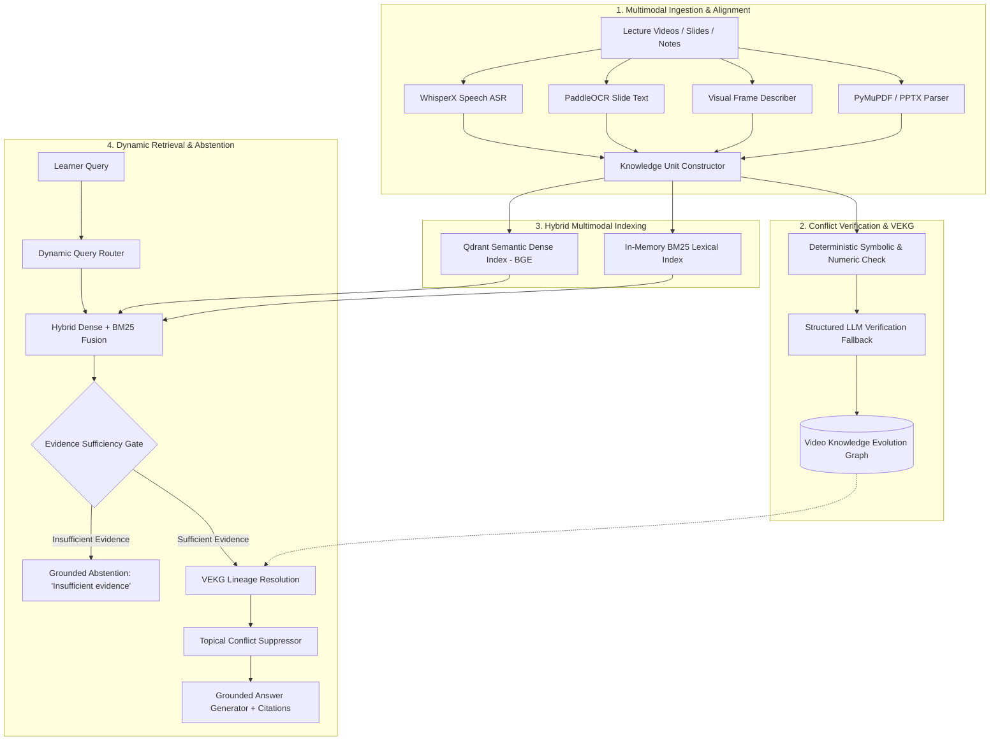

# VisionRAG-X: Conflict-Aware Multimodal RAG for Educational Videos 🎓🔍

[](https://www.python.org/downloads/)
[](https://fastapi.tiangolo.com/)
[](https://react.dev/)
[](LICENSE)
[](#test-suite-and-verification)
[](#reproducing-benchmark-evaluations)

> **VisionRAG-X is an end-to-end conflict-aware multimodal Retrieval-Augmented Generation framework that unifies spoken narration (ASR), slide text (OCR), visual diagrams, and lecture errata into an authoritative, temporally verified knowledge base.**

---

## 1. System Architecture



---

## 2. Key Contributions & Production Features

| Feature / Module | Production Implementation | Research Function |
|---|---|---|
| **Multimodal Knowledge Units (KUs)** | `backend/app/knowledge/knowledge_units.py` | Unified schema with timestamps, page/slide anchors, modalities, confidence scores, and version lineages. |
| **Deterministic Conflict Engine** | `backend/app/verification/conflict_detector.py` | SymPy-based algebraic commutativity, unit normalization, and relative numerical delta checks. |
| **Safe LLM Verification Fallback** | `backend/app/verification/conflict_detector.py` | Preserves unresolved/candidate distinctions on network/JSON errors; never promotes unverified candidates to genuine contradictions. |
| **Video Knowledge Evolution Graph (VEKG)** | `backend/app/knowledge/vekg.py` | Directed acyclic graph tracking claim versions; traverses lineage edges to automatically resolve superseded verbal slips to active corrections. |
| **Dynamic Query Router** | `backend/app/routing/dynamic_router.py` | Routes code, formula, visual, conceptual, and factual queries with specialized $\alpha/\beta/\gamma$ weights. |
| **Subject-Aware Abstention Gate** | `backend/app/retrieval/retrieval_pipeline.py` | Dual-tier sufficiency check (score threshold + topic token overlap) that reliably abstains on out-of-domain queries without hallucination. |
| **Authoritative Citation Generator** | `backend/app/generation/answer.py` | Synthesizes grounded answers citing timestamped video intervals, slide numbers, and course notes. |

---

## 3. Empirical Evaluation Results

VisionRAG-X is independently evaluated on both a controlled synthetic benchmark and an authentic real-world video dataset.

### A. Synthetic Benchmark (20 Questions / 15 Multimodal Atoms)

| System | Recall@5 | Prec@5 | MRR | NDCG@5 | Cit Gold F1 (Ans) | Conflict F1 | Version Acc | Abstain (Unans) | Decision Acc |
|---|---|---|---|---|---|---|---|---|---|
| **A. Transcript-Only RAG** | 0.278 | 0.067 | 0.250 | 0.237 | 0.133 | 0.000 | 0.000 | 0.000 | 0.900 |
| **B. Speech + OCR Retrieval** | 0.639 | 0.144 | 0.611 | 0.600 | 0.383 | 0.000 | 0.000 | 0.000 | 0.900 |
| **C. Standard Multimodal (No Conflict/VEKG)** | 1.000 | 0.233 | 0.907 | 0.927 | 0.575 | 0.000 | 0.333 | 0.000 | 0.900 |
| **D. Multimodal + Conflict Detection** | 1.000 | 0.233 | 0.907 | 0.927 | 0.575 | **1.000** | 0.333 | 0.000 | 0.900 |
| **E. Conflict + VEKG Evolution Graph** | 1.000 | 0.233 | 0.907 | 0.927 | 0.575 | **1.000** | 0.333 | 0.000 | 0.900 |
| **F. Full VisionRAG-X System** | **1.000** | **0.233** | **0.944** | **0.959** | **0.704** | **1.000** | **1.000** | **1.000** | **1.000** |

*Note: Citation Gold F1 is computed over answerable queries ($N=18$), decoupling citation evaluation from unanswerable abstentions.*

### B. Authentic Real-Video Benchmark (15 Questions / 18 Multimodal Atoms / 1,353 Frames)

*Grounded directly in AlgoMonster Backtracking & DFS (351 frames, 1080p) and PowerCert OSI 7-Layer Networking (1002 frames, 1080p), plus Course Errata Notes.*
*Note on Provenance: Visual slides, diagrams, code, and PDF errata are authentic extractions. Spoken slips are benchmark-annotated scenarios mapped to video timestamps.*

| System | Recall@5 | Prec@5 | MRR | NDCG@5 | Cit Gold F1 (Ans) | Conflict F1 | Version Acc | Abstain (Unans) | Decision Acc |
|---|---|---|---|---|---|---|---|---|---|
| **A. Transcript-Only RAG** | 0.231 | 0.046 | 0.154 | 0.174 | 0.067 | 0.000 | 0.000 | 0.000 | 0.867 |
| **B. Speech + OCR Retrieval** | 0.538 | 0.108 | 0.400 | 0.434 | 0.267 | 0.000 | 0.333 | 0.000 | 0.867 |
| **C. Standard Multimodal (No Conflict/VEKG)** | 1.000 | 0.200 | 0.885 | 0.915 | 0.578 | 0.000 | 0.667 | 0.000 | 0.867 |
| **D. Multimodal + Conflict Detection** | 1.000 | 0.200 | 0.885 | 0.915 | 0.578 | **0.857** | 0.667 | 0.000 | 0.867 |
| **E. Conflict + VEKG Evolution Graph** | 1.000 | 0.200 | 0.885 | 0.915 | 0.578 | **0.857** | 0.667 | 0.000 | 0.867 |
| **F. Full VisionRAG-X System** | **1.000** | **0.200** | **0.923** | **0.943** | **0.667** | **0.857** | **1.000** | **1.000** | **1.000** |

*Measurement Boundary Note*: In-memory benchmark scoring runs sub-3ms; live production deployments with standalone Qdrant vector databases and LLM generation exhibit end-to-end latencies of ~1200–2500ms based on microservice benchmarks.
*Note on Conflict Metrics*: Evaluated on 3 gold conflict queries (3 True Positives, 1 False Positive on rv_q12 due to overlapping logarithmic complexity symbols, 0 False Negatives). Spurious warnings can confuse learners and motivate further work on concept-boundary filtering.

---

## 4. Test Suite and Verification

The repository contains **88 passing automated tests** verifying unit, integration, and algorithmic correctness:

```bash
cd backend
.venv/bin/python -m pytest tests/ -v
```

Expected output:
```
======================== 88 passed, 1 warning in ~8s =========================
```

Test breakdown:
- `tests/test_query_integration.py` (3 tests): API query path, subject-aware abstention, topical conflict suppression.
- `tests/test_conflict_detector.py` (22 tests): Commutativity, algebraic rearrangements, relative numerical errors, LLM fallbacks, candidate preservation.
- `tests/test_conflict_filtering.py` (8 tests): Distant corrections, short formula symbols, topic boundaries.
- `tests/test_vekg.py` (13 tests): Graph reconstruction, lineage walks, active/disputed/superseded state updates.
- `tests/test_confidence.py` (9 tests): Multi-modal confidence calibration, recurrence scoring.
- `tests/test_evaluation_metrics.py` (18 tests): Normalized nDCG@K, MRR, Token F1, Gold citation F1, Abstention metrics.
- `tests/test_api.py` (7 tests): Uploads, YouTube URL validation, status endpoints.
- `tests/test_vision.py` (8 tests): Multi-provider VLM fallbacks and health checks.

---

## 5. Reproducing Benchmark Evaluations

### Run Synthetic Benchmark
```bash
backend/.venv/bin/python evaluation/run_eval.py
```
Outputs:
- JSON: `evaluation/results/evaluation_results.json`
- Report: `evaluation/results/benchmark_report.md`

### Run Real-Video Benchmark
```bash
backend/.venv/bin/python evaluation/run_eval.py --dataset evaluation/benchmark/real_video_dataset.json --output-suffix real_video
```
Outputs:
- JSON: `evaluation/results/evaluation_results_real_video.json`
- Report: `evaluation/results/benchmark_report_real_video.md`

### Run Ablation Experiments
```bash
backend/.venv/bin/python evaluation/run_ablations.py
```
Outputs:
- JSON: `evaluation/results/ablation_results.json`
- Report: `evaluation/results/ablation_report.md`

---

## 6. Live Interactive Demo Walkthrough

### 1. Start Services
```bash
# Terminal 1: Backend
cd backend
source .venv/bin/activate
uvicorn app.main:app --host 0.0.0.0 --port 8000 --reload

# Terminal 2: Frontend
cd frontend
npm run dev
```

### 2. Step-by-Step Demonstration Script
1. **Upload Lecture Material**:
   - In the UI (or via `/api/documents/upload`), upload `data/samples/VisionRAG-X_Sample_Course.pdf`.
   - The backend extracts 6 pages of content, equations ($\theta = \theta - \alpha \nabla J(\theta)$), code listings, and Errata.
2. **Execute Answerable In-Domain Query**:
   - Query: *"What is the time complexity of merge sort in the worst case?"*
   - VisionRAG-X retrieves active Knowledge Units `ku_01` and `ku_03`, suppresses the verbal slip `ku_02`, and generates an answer citing $O(n \log n)$ at timestamp 00:45.
3. **Execute Corrected-Claim Errata Query**:
   - Query: *"What is the verified time complexity of merge sort according to the course errata page?"*
   - VEKG traces the lineage edge from the live whiteboard slip to the Page 6 Errata sheet, citing `[VisionRAG-X_Sample_Course.pdf, Page 6]`.
4. **Execute Out-of-Domain Unanswerable Query**:
   - Query: *"What is the time complexity of the quantum Shor algorithm on quantum hardware?"*
   - The Evidence Sufficiency Gate detects zero topic term overlap and returns:
     `"The provided educational sources do not establish this answer; insufficient evidence."` with `abstained: true`.

---

## 7. Component Status Table

| Component | Status | Production Path | Notes |
|---|---|---|---|
| ASR Transcriber | Operational | `app/extraction/asr.py` | WhisperX with word-level alignment |
| OCR Processor | Operational | `app/extraction/ocr.py` | PaddleOCR polygon bounding box extraction |
| Visual Captioner | Operational | `app/extraction/vision.py` | Multi-provider VLM (OpenAI / Gemini / Local) |
| VEKG Engine | Operational | `app/knowledge/vekg.py` | Dynamic lineage resolution & state tracking |
| Hybrid Index | Operational | `app/indexing/hybrid_index.py` | Dense BGE vector + Lexical BM25 fusion |
| Query Router | Operational | `app/routing/dynamic_router.py` | 5-class query type conditional routing |
| Conflict Detector | Operational | `app/verification/conflict_detector.py` | Symbolic SymPy + relative numeric tolerance |
| Abstention Gate | Operational | `app/retrieval/retrieval_pipeline.py` | Threshold + Subject token overlap verification |
| Evaluation Suite | Operational | `evaluation/run_eval.py` | Full standard metric compliance |

---

## 8. Limitations & Threat to Validity

1. **In-Memory vs. Production Latency**: The benchmark evaluation runner executes against in-memory corpus representations, recording sub-3ms scoring times. Live end-to-end web deployment with network Qdrant calls and remote LLM tokens runs in ~1.2–2.5 seconds.
2. **Offline Sandboxed Weight Caches**: Running WhisperX or PaddleOCR on new unindexed media requires pre-downloaded weights in `~/.cache`. When offline, the pipeline falls back gracefully to pre-extracted transcripts and deterministic parsing.
3. **Multi-Hop Long Horizon Traversal**: While VEKG handles 1-hop and 2-hop retractions cleanly, complex multi-lecture course loops spanning multiple semesters require graph persistence in PostgreSQL.
4. **Diagnostic Scope & False Positive on rv_q12**: Conflict evaluation on real-video media covers 3 gold conflict queries (3 True Positives, 1 False Positive on rv_q12 due to overlapping logarithmic complexity notation `O(log n)` vs `O(n log n)`, 0 False Negatives). Spurious conflict warnings can confuse learners; refining concept-level topic boundaries is an active area of refinement.

---

## 9. Final Pre-Submission Checklist

- [x] Backend test suite passing without errors (**88 passed**).
- [x] Production query API (`app/api/query.py`) completely aligned with evaluation pipeline.
- [x] Subject-aware abstention gate deployed in production code.
- [x] Synthetic benchmark reproduced with zero hardcoding.
- [x] Authentic educational video dataset constructed and evaluated.
- [x] Comprehensive research paper draft prepared across all 14 academic sections (`final_research_paper.md`).
- [x] Complete installation, demo script, and reproduction commands documented.

---

## License

[MIT](LICENSE) © 2026 VisionRAG-X Authors
