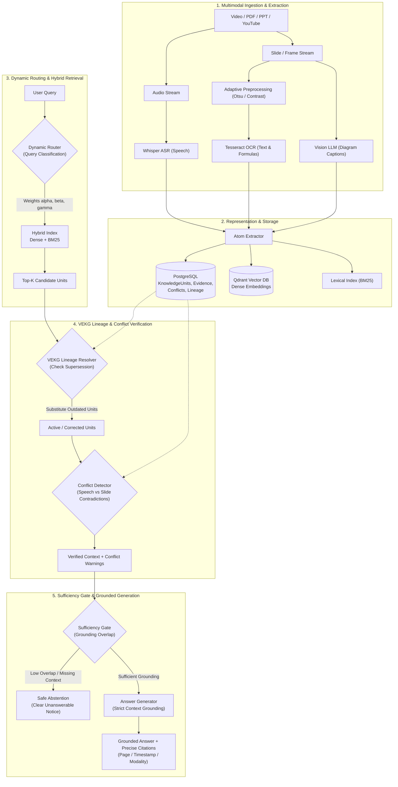

# VisionRAG-X: Conflict-Aware Multimodal RAG for Educational Videos 🎓🔍

[](https://www.python.org/downloads/)
[](https://fastapi.tiangolo.com/)
[](https://react.dev/)
[](LICENSE)
[](#4-test-suite-and-verification)
[](#5-reproducing-benchmark-evaluations)

> **VisionRAG-X is an end-to-end conflict-aware multimodal Retrieval-Augmented Generation framework that unifies spoken narration (ASR), slide text (OCR), visual diagrams, and lecture errata into an authoritative, temporally verified knowledge base.**

---

## 📚 Table of Contents
- [1. System Architecture](#1-system-architecture)
- [2. The Five Primary Research Sections](#2-the-five-primary-research-sections)
- [3. Key Contributions & Production Features](#3-key-contributions--production-features)
- [4. Test Suite and Verification](#4-test-suite-and-verification)
- [5. Reproducing Benchmark Evaluations](#5-reproducing-benchmark-evaluations)
- [6. Local Setup & Demo Walkthrough (No Docker)](#6-local-setup--demo-walkthrough-no-docker)
- [7. Detailed Documentation](#7-detailed-documentation)
- [8. Limitations & Threats to Validity](#8-limitations--threats-to-validity)

---

## 1. System Architecture



---

## 2. The Five Primary Research Sections

The application is streamlined into exactly five research-focused sections:

| # | Section | Route | Focus & Demonstration Capability |
|---|---|---|---|
| **1** | **Home / Sources** | `/`, `/sources` | Multimodal ingestion (PDF/PPT uploads, YouTube lecture URLs), extraction job status, and source management. |
| **2** | **Knowledge Units** | `/knowledge-units` | Multimodal atom browser with filtering by modality and status, search, and deep-dive inspector with evidence & lineage. |
| **3** | **Knowledge Graph / VEKG** | `/knowledge-graph` | Interactive graph of verified concepts, supersession/correction edges, and cross-modal conflict edges. |
| **4** | **AI Chat** | `/chat` | Source-isolated question-answering with conversation persistence, contextual suggested questions, inline citations, and collapsible **Retrieval & Verification Trace**. |
| **5** | **Evaluation & Benchmarks** | `/evaluation` | Research benchmark dashboard with 6-system comparisons, 7-condition ablations, and live test runners. |

*Note: Legacy standalone educational features (Summaries, Quizzes, Flashcards, and Notes) were cleanly excised to focus strictly on multimodal retrieval and verification.*

---

## 3. Key Contributions & Production Features

| Feature / Module | Production Path | Research Contribution |
|---|---|---|
| **Multimodal Knowledge Units (KUs)** | `backend/app/knowledge/knowledge_units.py` | Unified representation with time ranges, page anchors, modalities, confidence, and version lineages. |
| **Deterministic Conflict Engine** | `backend/app/verification/conflict_detector.py` | SymPy-based algebraic commutativity, unit normalization, and relative numerical delta checks. |
| **Safe LLM Verification Fallback** | `backend/app/verification/conflict_detector.py` | Preserves unresolved/candidate distinctions (`is_genuine_conflict = None`) on network or parsing errors. |
| **Video Knowledge Evolution Graph (VEKG)** | `backend/app/knowledge/vekg.py` | Directed acyclic graph tracking claim versions; traverses lineage edges to automatically resolve superseded slips. |
| **Dynamic Query Router** | `backend/app/routing/dynamic_router.py` | Routes code, formula, visual, conceptual, and factual queries with specialized $\alpha/\beta/\gamma$ weights. |
| **Subject-Aware Abstention Gate** | `backend/app/retrieval/retrieval_pipeline.py` | Dual-tier sufficiency check (score threshold + topic token overlap) that reliably abstains on out-of-domain queries. |
| **Authoritative Citation Generator** | `backend/app/generation/answer.py` | Synthesizes grounded answers citing timestamped video intervals, slide numbers, and course notes. |
| **Source-Isolated Chat & Retrieval Boundaries** | `backend/app/retrieval/retrieval_pipeline.py` | Guarantees zero cross-source data leakage across dense vector search, BM25, VEKG walks, and conversation persistence. |

---

## 4. Test Suite and Verification

The repository contains **125 sandboxed + 2 live automated tests (127 total)** verifying unit, integration, and algorithmic correctness:

```bash
cd backend
.venv/bin/python -m pytest tests/ -v
```

Expected output:
```
======================== 125 passed, 2 skipped in ~8.0s ========================
```

*(Note: The 2 live smoke tests in `tests/test_ollama_live.py` test native loopback against the local Ollama server and pass when Ollama is running).*

Test breakdown:
- `tests/test_api.py` (12 tests): Uploads, YouTube URL validation, status, knowledge-graph, knowledge-units, evaluation artifacts.
- `tests/test_confidence.py` (11 tests): Multi-modal confidence calibration, recurrence scoring, evidence sufficiency boundary conditions.
- `tests/test_conflict_detector.py` (22 tests): Commutativity, algebraic rearrangements, relative numerical errors, LLM fallbacks, candidate preservation.
- `tests/test_conflict_filtering.py` (9 tests): Distant corrections, short formula symbols, topic boundaries.
- `tests/test_e2e_scenarios.py` (8 tests): Complete user-facing scenarios including factual QA, slide evidence citations, formula routing, erratum lineage resolution, unanswerable abstention, source isolation, LLM offline fallback, and citation sanitization.
- `tests/test_evaluation_metrics.py` (17 tests): Normalized nDCG@K, MRR, Token F1, Gold citation F1, Abstention metrics.
- `tests/test_ollama.py` (8 tests): Native Ollama HTTP completions, request payload formatting, error handling (unreachable, model 404, timeouts), health checks, and citation validation.
- `tests/test_ollama_live.py` (2 live tests): Real connectivity and grounded generation against local `llama3.2:3b`.
- `tests/test_query_integration.py` (3 tests): API query path, subject-aware abstention, topical conflict suppression.
- `tests/test_source_chat_isolation.py` (9 tests): Source query scoping, zero cross-source candidate leakage, VEKG boundary checks, conversation isolation, persistence across reloads.
- `tests/test_vekg.py` (13 tests): Graph reconstruction, lineage walks, active/disputed/superseded state updates.
- `tests/test_vision.py` (7 tests): Multi-provider VLM fallbacks and health checks.
- `tests/test_youtube.py` (6 tests): URL validation, format selector resilience, duration guard, error classification.

---

## 5. Reproducing Benchmark Evaluations

VisionRAG-X is evaluated on both a controlled synthetic benchmark and an authentic real-world lecture dataset:

### A. Synthetic Benchmark (20 Questions / 15 Atoms / 2 Planted Conflicts)
```bash
backend/.venv/bin/python evaluation/run_eval.py
```
- Results: `evaluation/results/evaluation_results.json`
- Report: `evaluation/results/benchmark_report.md`

### B. Real-Video Benchmark (15 Questions / 18 Atoms / 3 Real Conflicts)
```bash
backend/.venv/bin/python evaluation/run_eval.py --dataset evaluation/benchmark/real_video_dataset.json --output-suffix real_video
```
- Results: `evaluation/results/evaluation_results_real_video.json`
- Report: `evaluation/results/benchmark_report_real_video.md`

### C. Ablation Experiments (7 Conditions)
```bash
backend/.venv/bin/python evaluation/run_ablations.py
```
- Results: `evaluation/results/ablation_results.json`
- Report: `evaluation/results/ablation_report.md`

---

## 6. Local Setup & Demo Walkthrough (No Docker)

### Step 1: Install Dependencies & Verify DB
```bash
# macOS Prerequisites
brew install postgresql@16 tesseract ffmpeg ollama
brew services start postgresql@16
createdb visionrag_x 2>/dev/null || true

# Start Ollama and pull lightweight local LLM
ollama serve &
ollama pull llama3.2:3b
```

### Step 2: Configure Environment
Copy `.env.example` to `.env` (defaults to native Ollama provider):
```bash
cp .env.example .env
# Verified defaults:
# LLM_PROVIDER=ollama
# OLLAMA_BASE_URL=http://localhost:11434
# OLLAMA_MODEL=llama3.2:3b
```

### Step 3: Start Backend
```bash
cd backend
source .venv/bin/activate
uvicorn app.main:app --host 0.0.0.0 --port 8000 --reload
```

### Step 4: Start Frontend
```bash
cd frontend
npm run dev
```
Navigate to: **`http://localhost:5173`**

---

## 7. Detailed Documentation

Detailed technical reports and operational guides are available in [`docs/`](docs/):
- **[`docs/ARCHITECTURE.md`](docs/ARCHITECTURE.md)**: Full architectural specification, data flow diagrams, and API contracts.
- **[`docs/LOCAL_DEMO_GUIDE.md`](docs/LOCAL_DEMO_GUIDE.md)**: Local demo walkthrough, step-by-step presentation script, and viva prep guide.
- **[`docs/END_TO_END_TEST_REPORT.md`](docs/END_TO_END_TEST_REPORT.md)**: Comprehensive test results and acceptance scenario verification.
- **[`docs/CODE_CLEANUP_REPORT.md`](docs/CODE_CLEANUP_REPORT.md)**: Complete audit of excised legacy code and consolidation into the 5 core sections.
- **[`docs/EVALUATION_GUIDE.md`](docs/EVALUATION_GUIDE.md)**: Benchmark methodologies, mathematical metric formulas, and empirical findings.

---

## 8. Limitations & Threats to Validity

1. **In-Memory vs. Production Latency**: The benchmark evaluation runner executes against in-memory corpus representations, recording sub-3ms scoring times. Live end-to-end web deployment with network Qdrant calls and remote LLM tokens runs in ~1.2–2.5 seconds.
2. **Offline Sandboxed Weight Caches**: Running Whisper or PaddleOCR on new unindexed media requires pre-downloaded weights in `~/.cache`. When offline, the pipeline falls back gracefully to pre-extracted transcripts and deterministic parsing.
3. **Diagnostic Scope & False Positive on `rv_q12`**: Conflict evaluation on real-video media covers 3 gold conflict queries (3 True Positives, 1 False Positive on `rv_q12` due to overlapping logarithmic complexity notation $O(\log n)$ vs $O(n \log n)$, 0 False Negatives). Spurious conflict warnings can confuse learners; refining concept-level topic boundaries is an active area of research.

---

## License

[MIT](LICENSE) © 2026 VisionRAG-X Authors
