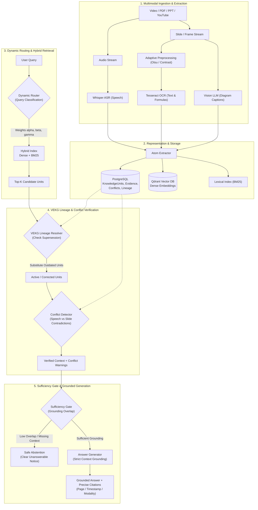
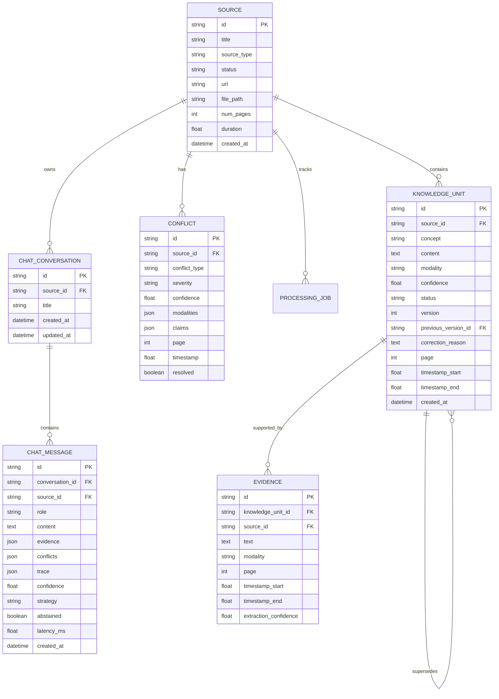

# VisionRAG-X: System Architecture & Technical Specifications

> **Framework**: VisionRAG-X — A Conflict-Aware Framework for Verified Multimodal Knowledge Retrieval from Educational Videos  
> **Authors**: Abhiram V (Final-Year Research Project)  
> **Repository**: `visionrag-x`

---

## 1. System Overview & Motivation

Educational video lectures present a severe challenge to standard Retrieval-Augmented Generation (RAG) pipelines:
1. **Multimodal Disconnect**: Critical concepts are divided across spoken explanations (ASR), slide bullet points (OCR), mathematical derivations (formula OCR), diagrammatic slides (vision captions), and code demonstrations.
2. **Temporal Errata & Pedagogical Drift**: Instructors frequently misspeak and verbally correct an equation moments later, or slides contain typographical errors corrected on the whiteboard. Traditional dense retrieval naively treats outdated statements as equally authoritative candidates.
3. **Cross-Modal Contradictions**: Spoken commentary and visual slide contents frequently conflict (e.g., instructor stating $O(n \log n)$ while slide displays $O(n^2)$). Without explicit conflict detection, language models hallucinate synthesized "compromises".
4. **Ungrounded Hallucinations**: Standard RAG pipelines attempt to answer queries even when evidence is completely absent or tangential, leading to fabricated explanations.

**VisionRAG-X** resolves these core failure modes through a unified 5-stage architecture incorporating dynamic query routing, cross-modal conflict detection, a Versioned Educational Knowledge Evolution Graph (VEKG), and an evidence sufficiency gate for calibrated abstention.

---

## 2. End-to-End System Pipeline

---

## 3. Core Architectural Modules

### 3.1. Multimodal Ingestion & Atom Extraction
- **Audio Extraction**: Extracts audio tracks and processes speech via OpenAI Whisper, generating time-aligned transcript segments.
- **Slide & Frame Processing**: Extracts high-resolution keyframes from video timestamps or renders PDF/PPT pages.
- **Adaptive OCR**: Applies image preprocessing (grayscale conversion, contrast enhancement, Otsu binarization) to maximize text and mathematical symbol recovery from low-contrast slides.
- **Vision Captioning**: Analyzes diagrams, plots, and charts using vision-language models to produce semantic textual descriptions.
- **Knowledge Atomization**: Normalizes extracted content into discrete `KnowledgeUnit` records with explicit attributes: `modality`, `timestamp_start`, `timestamp_end`, `page`, `confidence`, and `status`.

### 3.2. Hybrid Indexing & Dynamic Query Routing
- **Dense Vector Search**: Qdrant vector index storing normalized dense embeddings of knowledge unit contents.
- **Lexical Search**: BM25 / Bag-of-Words index preserving exact token matches for mathematical variables, algorithm names, and source code.
- **Dynamic Routing**: Classifies queries into 5 pedagogical categories (`code`, `formula`, `conceptual`, `factual`, `timestamp`) and dynamically adjusts the hybrid scoring weights:
  $$\text{Score}(q, u) = \alpha \cdot \text{Dense}(q, u) + \beta \cdot \text{Lexical}(q, u) + \gamma \cdot \text{Prior}(u)$$

### 3.3. Versioned Educational Knowledge Graph (VEKG)
- **Concept Lineage**: Connects knowledge units via directed edges (`corrects`, `supersedes`, `related_to`).
- **Correction Resolution**: When an instructor corrects a previous statement or an erratum slide updates an earlier formula, the new knowledge unit points to the superseded unit via `previous_version_id`.
- **Graph Traversal at Retrieval**: If an older superseded unit is retrieved during search, the VEKG traverser follows the lineage chain forward to substitute the superseded claim with its active, verified correction.

### 3.4. Cross-Modal Conflict Detector
- **Contradiction Detection**: Evaluates temporal sliding windows where speech commentary and visual slide text co-occur.
- **Symbolic Formula Normalization**: Parses equations into standardized symbolic representations to distinguish algebraic rearrangements (not conflicts) from genuine mathematical contradictions.
- **LLM Verification Fallback**: Evaluates candidate contradictions using an LLM verifier. If the verifier times out or returns malformed output, the conflict is preserved with status `is_genuine_conflict = None` (unresolved) rather than falsely discarded.

### 3.5. Evidence Sufficiency Gate & Abstention
- **Lexical-Semantic Overlap Gate**: Computes verified term overlap between the user query and retrieved evidence.
- **Deterministic Abstention**: When overlap falls below the grounding threshold, the pipeline abstains rather than invoking hallucinated generation.
- **Grounded Answer Generation**: Strictly constrains answers to verified evidence snippets, appending inline bracketed citations referencing source titles, modalities, and exact timestamps/pages.

---

## 4. API Endpoints Specification

| Method | Endpoint | Description |
|---|---|---|
| `GET` | `/health` | System health check (PostgreSQL, Qdrant, Models) |
| `POST` | `/api/upload` | Upload PDF, PPT, or video file for processing |
| `POST` | `/api/youtube` | Ingest YouTube video lecture with duration validation |
| `GET` | `/api/status/{source_id}` | Poll background ingestion progress and step logs |
| `GET` | `/api/sources` | List all ingested sources and their processing status |
| `GET` | `/api/source/{source_id}` | Get detailed metadata for an ingested source |
| `DELETE` | `/api/source/{source_id}` | Cascade delete source, knowledge units, vectors, chat sessions, and files |
| `GET` | `/api/knowledge-units` | Paginated search and filtering of knowledge units across modalities |
| `GET` | `/api/knowledge-units/{ku_id}` | Full detail view with evidence items, lineage chain, and conflicts |
| `GET` | `/api/knowledge-graph` | Full VEKG graph structure (nodes, lineage edges, conflict edges) |
| `POST` | `/api/query` | Full RAG pipeline: source validation, retrieval, VEKG resolution, conflict check, sufficiency gate, answer + trace |
| `GET` | `/api/chat/sources/{source_id}/conversation` | Get or auto-create active isolated conversation session and history for a source |
| `POST` | `/api/chat/sources/{source_id}/conversation/new` | Create fresh isolated conversation session for a source |
| `GET` | `/api/chat/sources/{source_id}/suggested-questions` | Get grounded suggested questions derived dynamically from indexed source concepts |
| `GET` | `/api/chat/sources/{source_id}/conversations` | List all past conversation sessions scoped to a source |
| `DELETE` | `/api/chat/conversations/{conversation_id}` | Delete a specific conversation session and its messages |
| `GET` | `/api/evaluation/artifacts` | Read real benchmark results, ablation matrices, and markdown reports |
| `POST` | `/api/evaluation/run` | Execute synthetic, real-video, or ablation evaluation scripts locally |

---

## 5. Storage Schema & Relationships

---

## 6. Multi-Source Chat Isolation & Boundary Guarantees

VisionRAG-X enforces strict per-source isolation at both database, retrieval, and interface tiers:

1. **Source Pre-Flight Validation**:
   - `source_id` is mandatory on all `/api/query` invocations. Missing or empty `source_id` returns HTTP `400 Bad Request`.
   - The referenced source is verified against PostgreSQL. Unknown sources return HTTP `404 Not Found`.
   - Incomplete or failed sources (`status != 'completed'`) return HTTP `409 Conflict`, prohibiting queries on unindexed content.

2. **Retrieval Scope Isolation**:
   - Both dense vector queries (Qdrant payload filter `source_id == target_source_id`) and BM25 lexical token matching operate strictly on knowledge units belonging to the requested `source_id`.
   - Raw candidate pools and top-K evidence lists cannot contain atoms from foreign sources.

3. **VEKG Traversal Boundary Enforcement**:
   - Lineage walk operations (`supersedes`, `corrects`) verify that both the active candidate and the candidate replacement share the exact same `source_id`. Cross-source lineage substitutions are prohibited.

4. **Temporal Cross-Modal Conflict Scoping**:
   - Candidate conflict detection operates strictly within the temporal and spatial boundaries of the targeted source.

5. **Conversation & Message Persistence**:
   - Conversations (`ChatConversation`) and message histories (`ChatMessage`) are bound directly to `source_id` with foreign key constraints.
   - Deleting a source via `DELETE /api/source/{source_id}` cascades deletion to all associated conversations and messages, preventing orphaned records.
   - UI clients switching between sources immediately wipe state and load the selected source's history, preventing visual bleed. Race conditions from in-flight requests are suppressed via reference guards.
